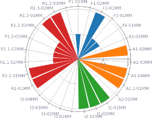
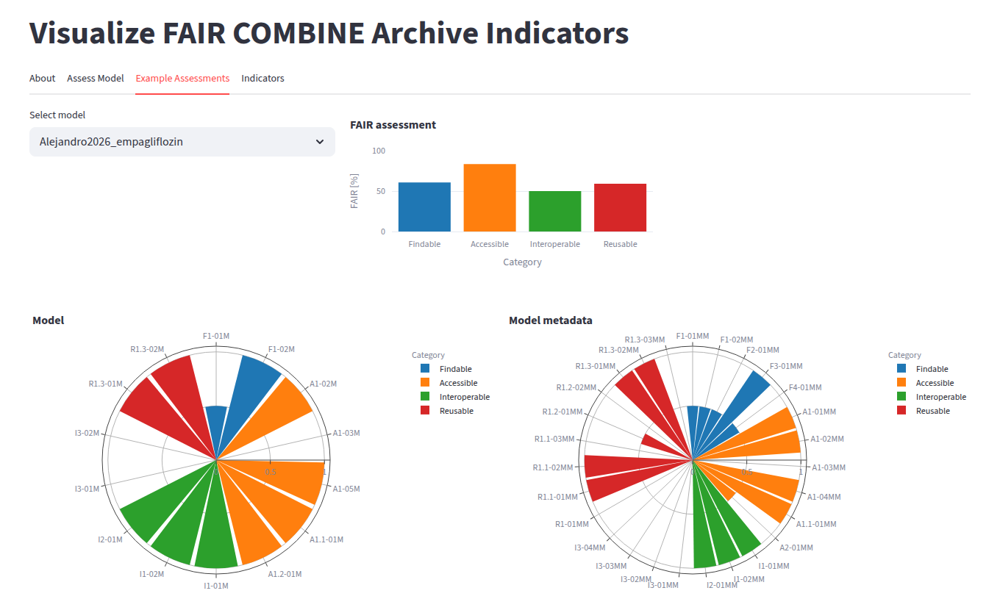

# fair-ca-visualization



Computational models are essential tools for studying complex systems which, particularly in clinical settings, need to be quality-approved and transparent. A community-driven approach to enhance the transparency and communication of model features is adherence to the principles of Findability, Accessibility, Interoperability and Reusability (FAIR). The FAIR COMBINE Archive Indicators (FAIR-CA) adapt the FAIR indicators published by the Research Data Alliance to assess the FAIRness of models encoded in domain-specific standards, such as those established by [COMBINE](https://co.mbine.org).

`fair-ca-visualization` visualizes FAIR-CA assessments interactively. It is available as a web app at [faircombine.streamlit.app](https://faircombine.streamlit.app) and as the python package [`fair-ca-visualization`](https://pypi.org/project/fair-ca-visualization/) to run the same app locally, see [Installation](installation.md).

[](https://faircombine.streamlit.app)

The FAIR COMBINE Archive Indicators project is available from [FAIR-CA-indicators.github.io](https://github.com/FAIR-CA-indicators/FAIR-CA-indicators.github.io) and described in

> Balaur I., Nickerson D.P., Welter D., Wodke J.A.H., Ancien F., Gebhardt T., Grouès V., Hermjakob H., König M., Radde N., Rougny A., Schneider R., Malik-Sheriff R.S., Shiferaw K.B., Stefan M., Satagopam V., Waltemath D. (2025). FAIRification of computational models in biology. bioRxiv 2025.03.21.644517. [doi:10.1101/2025.03.21.644517](https://doi.org/10.1101/2025.03.21.644517)

## How to cite

[](https://doi.org/10.5281/zenodo.13755820)

> König M. fair-ca-visualization: interactive visualization of the FAIR COMBINE Archive Indicators. Zenodo. [doi:10.5281/zenodo.13755820](https://doi.org/10.5281/zenodo.13755820)

```bibtex
@software{fair_ca_visualization,
  author    = {König, Matthias},
  title     = {fair-ca-visualization: interactive visualization of the FAIR COMBINE Archive Indicators},
  publisher = {Zenodo},
  doi       = {10.5281/zenodo.13755820},
  url       = {https://doi.org/10.5281/zenodo.13755820}
}
```

The DOI is the concept DOI and always resolves to the latest release; each release has its own version DOI on [Zenodo](https://doi.org/10.5281/zenodo.13755820).

## License

- Source code: [MIT](https://opensource.org/license/MIT)
- Documentation: [CC BY-SA 4.0](https://creativecommons.org/licenses/by-sa/4.0/)

## Funding

Matthias König (MK) was supported by the Federal Ministry of Education and Research (BMBF, Germany) within the research network Systems Medicine of the Liver (LiSyM, grant number 031L0054). MK is supported by the Federal Ministry of Education and Research (BMBF, Germany) within ATLAS by grant number 031L0304B and by the German Research Foundation (DFG) within the Research Unit Program FOR 5151 QuaLiPerF (Quantifying Liver Perfusion-Function Relationship in Complex Resection - A Systems Medicine Approach) by grant number 436883643 and by grant number 465194077 (Priority Programme SPP 2311, Subproject SimLivA).
