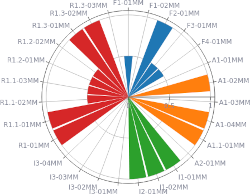

# Release notes for fair-ca-visualization 0.5.2

This patch release updates the application dependencies and development tools.

## Dependencies

- update the locked Python dependencies, including pandas 3.1.0, pyarrow 26.0.0 and Streamlit 1.66.1
- refresh the minimum versions of the direct dependencies to match the tested environment

## Development

- merge all three Dependabot updates for Python dependencies, GitHub Actions and pre-commit hooks (#24, #25, #26)
- update uv from 0.12.21 to 0.13.6 in all workflows
- keep the ruff 0.17.3 and ty 0.0.95 pre-commit hooks aligned with the locked tools
- update the remaining development dependencies, including bump-my-version 1.8.1 and Zensical 0.0.74

Your fair-ca-visualization team
